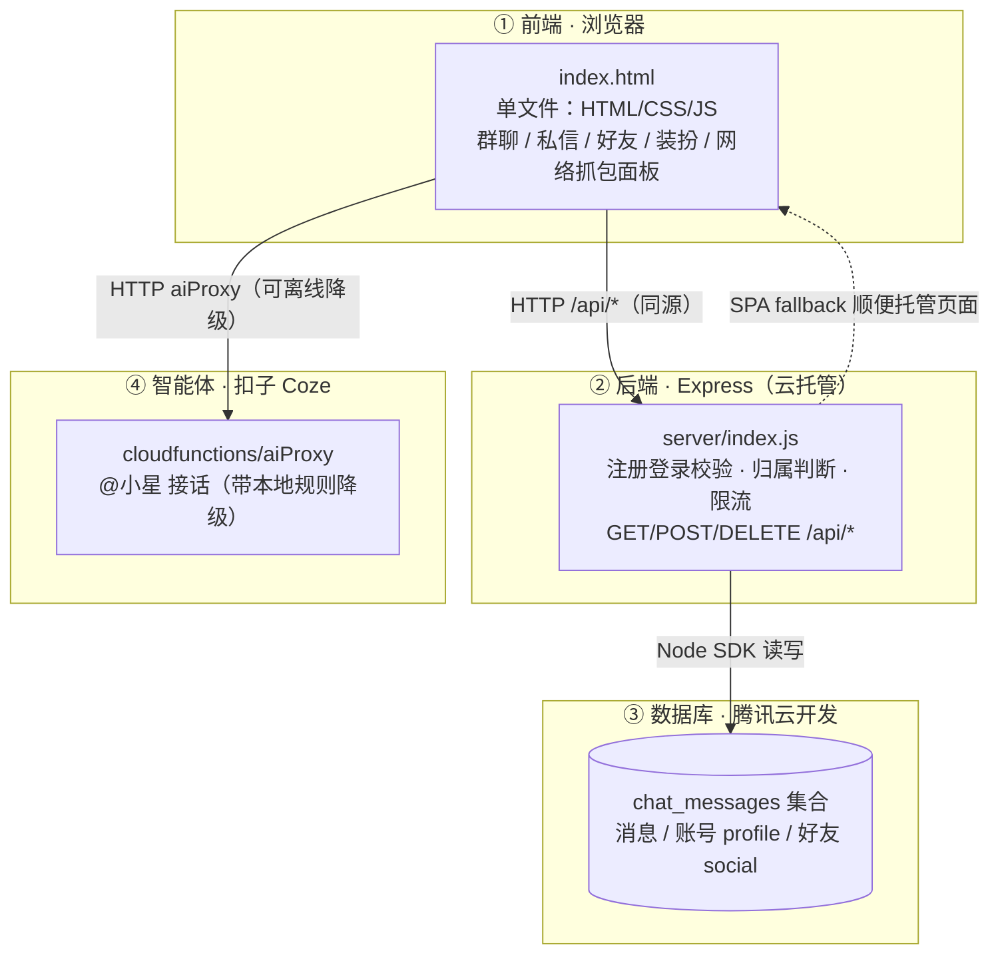

# 星火聊天室 · 腾讯云版

一个把 **前端 + 后端 + 数据库 + 智能体** 四层都打通的群聊应用，作为计算机网络课程大作业。单文件前端 `index.html`（内嵌全部 CSS/JS/图片）+ Express 后端 + 腾讯云开发数据库 + Coze 智能体，可本地零配置演示，也可一键部署成云托管单服务。

---

## 一、项目架构（四层）



**数据流说明**（答辩可直接讲）：

1. 页面打开时自动请求 `GET /api/health`，通了就走 **后端 API 模式**（右上角徽章变 🌐），否则自动退回本地/云数据库模式，页面照样能用。
2. 注册、登录、发消息、删消息、加好友都发到同源 `/api/*`，**校验和归属判断在服务端完成**，前端只负责展示。
3. 服务端用 `@cloudbase/node-sdk` 把数据落到云数据库 `chat_messages` 集合；没配云环境时用本地 JSON 文件兜底。
4. `@小星` 把问题发给扣子智能体云函数；网络不可用时自动降级成内置规则助手，离线也能演示。

---

## 二、技术栈与计网知识点

| 层 | 技术 | 对应课程知识点 |
|---|---|---|
| 前端 | 原生 HTML/CSS/JS，单文件 | HTTP 请求构造、同源策略、轮询同步 |
| 后端 | Node.js + Express，RESTful API | HTTP 方法/状态码、路由、鉴权（Bearer Token）、限流 |
| 数据库 | 腾讯云开发 CloudBase（或本地 JSON 兜底） | 数据持久化、集合设计、跨设备同步 |
| 智能体 | 扣子 Coze + 云函数代理 | HTTP 代理、超时控制、降级容错 |
| 部署 | 云托管单服务（页面 + 接口同容器） | 域名、端口映射、同源部署、Docker |

> 页面内置了一个 **「网络」抓包面板**（左侧栏「数据 → 网络」），实时记录每一次 HTTP 请求的方法、路径、状态码、往返耗时、请求/响应体大小 —— 可以直接给老师演示客户端与服务端之间的通信过程。

---

## 三、三种运行方式

| 方式 | 后端 | 数据库 | 适用场景 |
|---|---|---|---|
| **A. 本地直接看** | 无 | 浏览器本地存储 | 零配置快速演示，双击 `index.html` 即可 |
| **B. 静态托管 + 云数据库** | 无（前端直连） | CloudBase | 只要一个网址，业务逻辑在浏览器 |
| **C. 云托管单服务（推荐）** | Express | CloudBase | **有独立后端 + 一个域名全包，交作业首选** |

**方式 C 部署要点**：
1. 云开发控制台 → 云托管 → 新建服务，仓库指向本仓库，**目标目录填 `.`（仓库根）**，端口 80。
2. 环境变量：`TCB_ENV=你的环境ID`、`DB_DRIVER=cloudbase`、`TOKEN_SECRET=随机串`。
3. `index.html` 顶部 `CHAT_CONFIG.apiBase` 保持留空（自动探测同源 `/api/health`）。
4. 打开服务域名，右上角徽章显示 🌐 后端 API 即成功。

详细步骤见 [`docs/云托管部署指南.md`](docs/云托管部署指南.md)，接口清单见 [`docs/后端接口文档.md`](docs/后端接口文档.md)。

---

## 四、功能一览

- 注册 / 登录（服务端校验、账号跨设备可登录）
- 群聊大厅、个人视图、好友申请与私聊（按 uid 隔离）
- 图片 / 文件 / 语音消息，表情、贴纸
- `@小星` 智能问答（带历史上下文 + 离线降级）
- 9 套聊天气泡装扮、亮/暗主题、可更换头像
- **数据库面板**：消息表 / 账号表 / 好友关系表，摊开给老师检查
- **网络抓包面板**：实时 HTTP 请求记录
- 限流（60 秒最多 8 条）、消息归属校验删除

---

## 五、目录结构

```
chatroom_local/
├── index.html                 # 前端单文件（页面 + 样式 + 逻辑 + 内嵌素材）
├── server/
│   ├── index.js               # Express 后端：/api/* + 静态托管
│   ├── data/db.json           # 本地兜底数据（云托管时用云数据库）
│   └── Dockerfile
├── cloudfunctions/aiProxy/    # 扣子智能体 HTTP 代理云函数
├── docs/                      # 部署 / 接口 / 智能体 / 数据库说明
├── Dockerfile                 # 根 Dockerfile（云托管单服务用）
└── README.md                  # 本文件
```

---

## 六、演示建议

1. 打开页面（本地模式或云托管域名均可），先注册两个账号 A、B。
2. A 在群聊发消息、发图片、@小星提问；切到「网络」面板即可看到刚才的 HTTP 请求。
3. 切到「数据库」面板，逐一展示消息表 / 账号表（密码哈希遮罩）/ 好友关系表。
4. A 加 B 好友 → B 同意 → 私聊，演示 uid 隔离与归属校验。
5. 切换亮/暗主题、挑一套气泡装扮，展示前端交互。
6. 断开网络再 @小星，展示智能体离线降级。

> 清本地演示数据：浏览器 F12 → Application → Local Storage → 删掉 `spark_chat_` 开头的键。

---

## 七、仓库

https://github.com/Cxily117/chatroom.git
